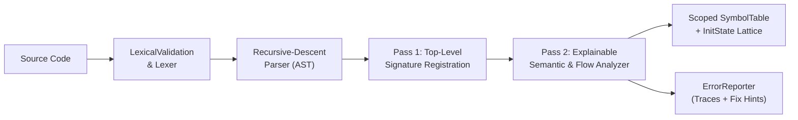

# Final Presentation Slide Deck (100% Assessment & Demo)
**Title**: *Explainable Semantic Analysis with Scope and Definite-Assignment Checking*  
**Demo Date**: 21 October 2026 | **Final Submission**: 30 October 2026 (`RegisterNumber_StudentName`)

---

## Slide 1: Title & Project Overview
- **Title**: Explainable Semantic Analysis with Scope and Definite-Assignment Checking
- **Subtitle**: A C++17 Compiler Front-End with Flow-Sensitive Initialization Lattices, Shadowing Traces, and Cascading Suppression
- **Progression Across Milestones**:
  - **Review I (25%)**: Lexical Analyzer (`build/review_1.exe`) — Token recognition, coordinates, lexical validation.
  - **Review II (75%)**: Core Semantic Analyzer (`build/semantic_demo.exe`) — Recursive-descent parser, AST, lexical scopes, scalar/function type checking.
  - **Final Review (100%)**: Explainable Flow-Aware Semantic Analyzer (`build/semantic_final.exe`) — Flow-sensitive definite assignment, branch/loop merging, lexical shadowing traces, 1D arrays, forward/mutual recursion, return-path checking, and 40-program empirical benchmark.

> **Speaker Notes**: Welcome the panel. Highlight that our 100% submission completes every deferred milestone item from Review II—specifically flow-aware uninitialized variable detection, explainable scope/branch diagnostics, and a 40-program automated empirical evaluation comparing the 75% baseline against the 100% enhanced analyzer.

---

## Slide 2: Problem Statement & Motivation
- **Why Standard Teaching Compilers Fall Short**:
  1. **Control-Flow Blindness**: Standard symbol tables only record static declarations (`int x;`), missing uninitialized reads across `if` without `else`, one-sided `if-else`, or zero-trip `while` loops (*False Negatives*), or falsely rejecting valid multi-branch initialization (*False Positives*).
  2. **Opaque Diagnostics on Shadowing & Flow**: `error: 'x' may be used uninitialized` or `type mismatch` at line 10 fails to tell a novice *which branch missed the assignment* or *which outer declaration was shadowed*.
  3. **Cascading Error Avalanches**: A single undeclared variable or ill-typed subexpression triggers multiple secondary errors down the AST and basic block.

> **Speaker Notes**: Motivate the research and pedagogical problem: novice programmers need diagnostics that connect the failure site back to the exact declaration line, the control-flow path that failed to initialize the variable, and any shadowed outer symbol.

---

## Slide 3: Literature Survey & Theoretical Foundation
| Foundational Work | Core Concept | Our Adaptation & Extension |
| :--- | :--- | :--- |
| **Dunfield & Krishnaswami (2021)** *Bidirectional Typing* | Bottom-up synthesis ($\Rightarrow$) vs. top-down checking ($\Leftarrow$). | Synthesizes `inferredType` on expressions, checks against expected target types, and propagates `TYPE_ERROR`. |
| **Java Language Spec (JLS Ch. 16)** & **Fruja (2004)** | Syntax-directed definite-assignment equations ($\text{in}[S], \text{out}[S]$). | Extends boolean definite assignment to a 4-point provenance lattice recording *why* and *where* assignment was missed. |
| **TypeScript Control Flow Narrowing** | Environment cloning across branches, join-point merging, early-return pruning. | Implements `captureInitEnv`/`restoreInitEnv` and `guaranteesReturn` pruning on `if-else` and `while` AST nodes. |
| **Clang Expressive Diagnostics** & **Becker et al. (2016, 2019)** | Carets, source snippets, Fix-It hints, and declaration linking. | Generates unified **Branch/Loop Provenance Reasons**, **Lexical Scope Traces**, and `Possible correction:` hints. |

> **Speaker Notes**: Walk through the four pillars of our literature survey and emphasize how we combine JLS definite assignment with Clang-style provenance and scope-shadowing traces.

---

## Slide 4: Supported Language Grammar & Type Rules
- **Static Type System**: `int`, `float`, `bool`, `char`, `void`, fixed-size 1D arrays (`int arr[5];`), functions, and `TYPE_ERROR`.
- **Implicit Conversion Rule**: Only safe numeric widening `int` $\rightarrow$ `float` is allowed; narrowing (`float` $\rightarrow$ `int`) and `int` $\leftrightarrow$ `bool` are rejected.
- **Control-Flow & Structural Rules**:
  - `if (cond)` and `while (cond)` strictly require `cond : bool`.
  - Two-pass top-level registration supports **forward function calls** and **mutual recursion**.
  - Non-void functions must guarantee a return across all structural paths (`guaranteesReturn`).

> **Speaker Notes**: Briefly summarize the language grammar and static type rules implemented in `later/src/Parser.cpp` and `later/src/Type.cpp`.

---

## Slide 5: Formal Definite-Assignment Lattice & Transfer Equations
- **4-Element Initialization Lattice**:
  $$\mathcal{L} = \{\top \text{ (Returned)}, \;\text{Init} \text{ (\texttt{DEFINITELY\_INITIALIZED})}, \;\text{MayUninit}(\rho) \text{ (\texttt{MAYBE\_INITIALIZED})}, \;\text{Uninit} \text{ (\texttt{UNINITIALIZED})}\}$$
- **Control-Flow Merge ($\sqcap$) Rules**:
  - **`if (c) S_then else S_else`**:
    - $\text{Init} \sqcap \text{Init} = \text{Init}$ (assigned in both branches $\rightarrow$ valid!).
    - $\text{Init} \sqcap \top = \text{Init}$ (one branch returns early, the other assigns $\rightarrow$ valid!).
    - $\text{Init} \sqcap \text{Uninit} = \text{MayUninit}(\rho)$ (records whether `then`, `else`, or missing `else` failed to assign).
  - **`while (c) S_body`**:
    - Because a `while` loop may execute **zero times**, $\text{Uninit}_{\text{pre}} \text{ with } \text{Init}_{\text{body}} \implies \text{MayUninit}(\text{``while loop on line }\ell\text{ may execute zero times''})$.

> **Speaker Notes**: Explain the mathematical heart of Phase 2: our 4-element lattice and why `while` loops and one-sided `if` statements merge to `MAYBE_INITIALIZED` while two-sided `if-else` statements merge to `DEFINITELY_INITIALIZED`.

---

## Slide 6: System Architecture Pipeline

- **Four Inspection Views (`--all`)**:
  1. `--dump-tokens`: Token stream with line/column coordinates.
  2. `--dump-ast`: Initial syntactic AST.
  3. `--dump-typed-ast`: Type-annotated AST after bottom-up synthesis.
  4. `--dump-symbols`: Hierarchical lexical scope table (`Global` $\rightarrow$ `Function` $\rightarrow$ `Block@L...`).

> **Speaker Notes**: Show how `later/src/main_3.cpp` orchestrates lexical validation, tokenization, parsing, two-pass semantic/flow analysis, and the four diagnostic views.

---

## Slide 7: Implementation Deep Dive (`shared/` & `later/src/`)
- **Symbol Table Extensions (`shared/SymbolTable.hpp/.cpp`)**:
  - `Symbol` stores `InitState initState`, `std::string uninitReason`, `int uninitBranchLine`, and `bool reportedUninitRead`.
  - `SymbolTable::lookupShadowed(name)` traverses enclosing scopes beyond the innermost match to detect shadowed declarations.
- **Environment Cloning (`later/src/SemanticAnalyzer.cpp`)**:
  - `captureInitEnv()` and `restoreInitEnv()` snapshot active symbols keyed by `(scope->id, sym.name)`.
  - Self-referential initializers (`int x = x + 1;`) and assignments (`x = x + 10;`) evaluate the RHS *before* promoting `x` to `DEFINITELY_INITIALIZED`.

> **Speaker Notes**: Highlight the C++17 data structures in `shared/SymbolTable.hpp` and `later/src/SemanticAnalyzer.cpp`, especially how keying by `(scope->id, sym.name)` keeps shadowed variables completely independent.

---

## Slide 8: Worked Example 1 — Branch-Conditional Uninitialized Read
**Test Case (`catB_05_error_if_without_else.txt` vs. `catB_01_valid_ifelse_both_assigned.txt`)**:
```c
int main() {
    bool flag = true;
    int x;
    if (flag) {
        x = 10;
    }
    return x; // Line 8
}
```
- **Baseline (`semantic_demo.exe`)**: `0 errors` *(False Negative — bug missed!)*
- **Enhanced (`semantic_final.exe`)**:
```text
[SEMANTIC ERROR] line 8, col 12
    return x;
           ^
Reason: Variable 'x' (declared on line 4) may be uninitialized here (used on line 8) because the branch where 'flag' is false (missing else on line 5) does not assign it.
Possible correction: Initialize 'x' at its declaration on line 4 or ensure all control-flow paths assign a 'int' value before line 8.
```

> **Speaker Notes**: Contrast the Baseline output with our Enhanced output. When `else { x = 20; }` is added (`catB_01`), the Enhanced Analyzer merges both branches to `DEFINITELY_INITIALIZED` and passes with 0 errors!

---

## Slide 9: Worked Example 2 — Loop-Conditional Uninitialized Read
**Test Case (`catC_03_error_while_only_init.txt`)**:
```c
int main() {
    bool cond = true;
    int x;
    while (cond) {
        x = 42;
        cond = false;
    }
    return x; // Line 9
}
```
- **Enhanced (`semantic_final.exe`) Output**:
```text
[SEMANTIC ERROR] line 9, col 12
    return x;
           ^
Reason: Variable 'x' (declared on line 4) may be uninitialized here (used on line 9) because the while loop on line 5 may execute zero times.
Possible correction: Initialize 'x' at its declaration on line 4 or ensure all control-flow paths assign a 'int' value before line 9.
```

> **Speaker Notes**: Explain why static analysis cannot assume a `while` loop executes at least once, and how our analyzer clearly explains the zero-trip loop reason to the student.

---

## Slide 10: Worked Example 3 — Lexical Shadowing Scope Traces
**Test Case (`catD_06_error_shadowed_type_mismatch_assign.txt` & `catD_04_error_shadowed_inner_uninit.txt`)**:
```c
int main() {
    int x = 10;
    {
        bool x = true;
        x = 25; // Line 6
    }
    return x;
}
```
- **Enhanced (`semantic_final.exe`) Output**:
```text
[SEMANTIC ERROR] line 6, col 9
        x = 25;
        ^
Reason: Type mismatch in assignment: cannot assign 'int' to variable 'x' of type 'bool' (declared on line 5) Scope trace: 'x' resolves to the bool declared on line 5 (shadowing the int declared on line 3).
Possible correction: Assign a value compatible with 'bool'; only int-to-float widening is implicit.
```

> **Speaker Notes**: Point out the `Scope trace:` generated by `lookupShadowed()`. Students immediately see that `x` on line 6 resolved to the inner `bool` on line 5 rather than the outer `int` on line 3.

---

## Slide 11: Four-Layer Cascading Error Suppression
1. **`TYPE_ERROR` Expression Poisoning**: `(flag + 5) * 10 - 2` (`catE_06`) emits **1 error** on `flag + 5` and suppresses secondary errors on `* 10` and `- 2`.
2. **Scope-Aware Undeclared Poisoning (`poisonedIdentifiers`)**: Reusing an undeclared variable `missing` 3 times (`catE_04`) emits **1 error** (vs. **3 errors** in Baseline).
3. **Basic-Block Uninitialized Deduplication (`reportedUninitRead`)**: Reading uninitialized `x` across 3 statements in the same block (`catE_05`) emits **1 error** on the first read and suppresses duplicate warnings.
4. **Post-Error Initialization Promotion**: An ill-typed assignment `x = true;` (`catE_07`) reports the type mismatch once and marks `x` initialized so downstream reads do not trigger false uninitialized cascades.

> **Speaker Notes**: Explain how these four mechanisms work together so a single mistake produces a single, high-precision diagnostic.

---

## Slide 12: Automated Evaluation Benchmark (40 Test Programs)
- **Automated Harness (`evaluation/run_eval.py` $\rightarrow$ `evaluation/RESULTS.md`)**:

| Metric | Baseline (`semantic_demo.exe`) | Enhanced (`semantic_final.exe`) | Improvement |
| :--- | :---: | :---: | :---: |
| **True Positives (TP / 25 Faulty)** | 8 / 25 (32.0%) | **25 / 25 (100.0%)** | **+17 (+68.0% recall)** |
| **False Negatives (Missed Bugs)** | 17 | **0** | **-17 (100% eliminated)** |
| **True Negatives (TN / 15 Valid)** | 15 / 15 | **15 / 15** | 100% valid code accepted |
| **False Positives (Naive Check = 11)** | 0 | **0** | **0 false alarms** |
| **F1-Score (%)** | 48.5% | **100.0%** | **+51.5 percentage points** |
| **Cascading / Extra Diagnostics** | 2 | **0** | **100% cascades suppressed** |
| **Explanation Completeness Score** | 0.0% (0/25) | **100.0% (25/25)** | **+100.0 percentage points** |
| **Total Runtime (40 Programs)** | 64.93 ms | **64.90 ms** | ~1.62 ms / program |

> **Speaker Notes**: Present the empirical numbers from `evaluation/RESULTS.md`. Highlight the jump from 32% recall to 100% recall, 0 false positives (avoiding 11 naive-check false alarms), 0 cascading errors, and 100% explanation completeness.

---

## Slide 13: Live Demonstration Commands
Run directly from the project root:
```bash
# 1. Build all milestones (25%, 75% baseline, 100% enhanced)
./scripts/build.sh

# 2. Run the 40-program automated benchmark evaluation
python3 evaluation/run_eval.py

# 3. Inspect branch, loop, and shadowing explainable diagnostics
./build/semantic_final.exe evaluation/test_corpus/catB_05_error_if_without_else.txt
./build/semantic_final.exe evaluation/test_corpus/catC_03_error_while_only_init.txt
./build/semantic_final.exe evaluation/test_corpus/catD_06_error_shadowed_type_mismatch_assign.txt
./build/semantic_final.exe --all evaluation/test_corpus/catE_01_valid_complex_functions_and_branches.txt
```

> **Speaker Notes**: Switch to the terminal during the live demo and run these exact commands to show compilation, the 40-test benchmark table, and live explainable outputs.

---

## Slide 14: Conclusion, Limitations & Future Scope
- **Summary of Achievements**:
  - 100% completion of flow-aware definite-assignment analysis (`DEFINITELY_INITIALIZED`, `MAYBE_INITIALIZED`, `UNINITIALIZED`, $\top$).
  - Multi-point explainable diagnostics with branch/loop provenance and lexical shadowing traces.
  - 100% recall, 100% precision, 0 cascading errors, and 100% explanation completeness across 40 benchmark programs.
- **Limitations & Future Work**:
  - Structural control-flow analysis is path-insensitive to constant boolean conditions (`if (true)`).
  - Future extensions: constant-condition folding, per-index static array initialization/bounds tracking, and classroom user study on student bug-repair speed.

> **Speaker Notes**: Conclude the presentation and invite questions from the evaluation panel.
