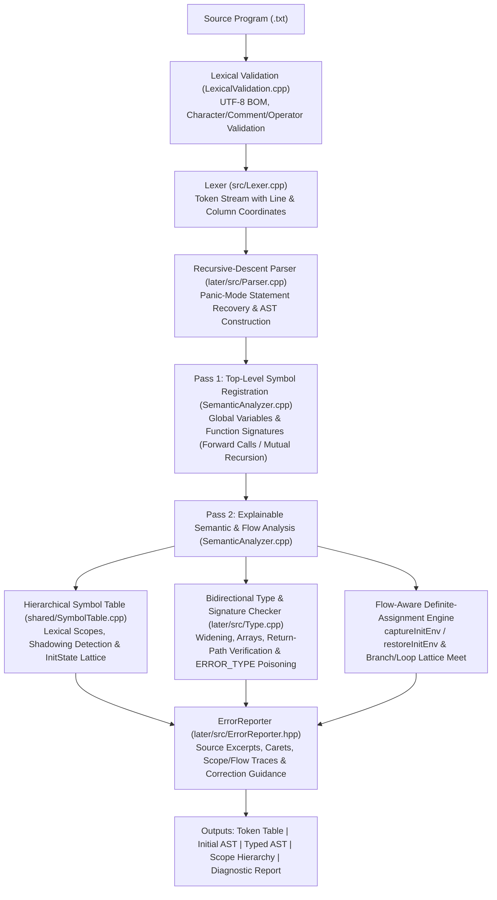

# Explainable Semantic Analysis with Scope and Definite-Assignment Checking

**Course**: Compiler Design Lab — Final Assessment (100% Milestone)  
**Project Title**: Explainable Semantic Analysis with Scope and Definite-Assignment Checking  
**Implementation Language**: C++17 (`src/`, `shared/`, `later/src/`)  
**Evaluation Benchmark**: 40 Labeled Test Programs (`evaluation/test_corpus/`)  

---

## 1. Problem Statement and Objectives

### 1.1 Problem Statement
In traditional compiler construction courses and production toolchains (such as GCC or standard recursive-descent teaching compilers), semantic analysis focuses primarily on **type checking** and **lexical name resolution**: verifying that identifiers are declared before use, enforcing scope rules, checking operator/operand compatibility, and validating function call signatures. However, two critical gaps remain in standard teaching-oriented semantic analyzers:

1. **Absence of Flow-Aware Definite-Assignment Analysis**: Standard symbol tables record only static declaration attributes (identifier name, type, scope level, and declaration line) or a static boolean flag indicating whether an initializer was syntactically present at declaration time (`int x = 5;` vs. `int x;`). Such an approach either **misses uninitialized variable reads** entirely (producing *false negatives* when `int x;` is read before assignment, or assigned in only one branch of an `if-else` or inside a `while` loop that may execute zero times) or, if enforced naively at declaration time, **falsely rejects valid programs** (producing *false positives* when `int x;` is initialized later across both `then` and `else` branches before being read).
2. **Terse, Context-Free Diagnostics and Cascading Error Noise**: When a semantic rule fails—particularly in the presence of **lexical variable shadowing** or **partial control-flow initialization**—conventional compilers emit terse messages at the point of use (e.g., `error: 'x' may be used uninitialized` or `error: invalid operands to binary +`). Novice programmers struggle to connect the failure site back to (a) the exact declaration selected by lexical scoping (versus an outer shadowed declaration of the same name), (b) the specific branch or loop control-flow path that failed to initialize the variable, and (c) the concrete repair required. Furthermore, a single undeclared identifier or ill-typed subexpression often triggers a cascade of secondary errors across parent expressions and subsequent basic-block reads.

### 1.2 Project Objectives
To address these limitations, this project designs, implements, and empirically evaluates an **Explainable Semantic Analyzer with Scope and Flow-Aware Definite-Assignment Checking** in C++17 (`later/src/`), achieving the following objectives:

1. **Complete Core & Advanced Semantic Validation**: Enforce lexical scoping, nested block hierarchies, shadowing, duplicate declaration detection, scalar and 1D array type checking, implicit `int` $\rightarrow$ `float` widening, function signature/argument checking, two-pass forward reference and mutual recursion resolution, and structural return-path verification.
2. **Lattice-Based Flow-Aware Definite-Assignment Tracking**: Track variable initialization states across control flow using a formal lattice $\mathcal{L} = \{\top, \text{DEFINITELY\_INITIALIZED}, \text{MAYBE\_INITIALIZED}, \text{UNINITIALIZED}\}$, cloning and merging environments across `if`, `if-else`, early-return branches, and zero-trip `while` loops.
3. **Multi-Point Explainable Diagnostics with Scope & Control-Flow Traces**: Generate structured diagnostics that explicitly link (i) the failure site (line, column, source excerpt, caret), (ii) the resolved declaration site, (iii) a **Lexical Scope Trace** when the resolved symbol shadows an outer declaration (`'x' resolves to the <type> declared on line <L1> (shadowing the <type> declared on line <L2>)`), (iv) a **Control-Flow Path Explanation** identifying the exact branch or loop line where initialization was missed, and (v) actionable correction guidance.
4. **Cascading Error Suppression**: Prevent secondary diagnostic noise using `TYPE_ERROR` (`ERROR_TYPE`) propagation across AST expressions, scope-aware identifier poisoning for undeclared names, post-error initialization promotion on invalid assignments/initializers, and per-basic-block suppression of duplicate uninitialized reads (`reportedUninitRead`).
5. **Rigorous Empirical Benchmarking**: Evaluate the Baseline Analyzer (`build/semantic_demo.exe`) against the Enhanced Analyzer (`build/semantic_final.exe`) on a labeled corpus of **40 benchmark programs** across 5 categories (`evaluation/test_corpus/`).

---

## 2. Literature Survey & Motivation

### 2.1 Comparative Analysis of Foundational Works
Our design synthesizes principles from four primary pillars of programming language theory and compiler engineering, complemented by empirical research on novice compiler error messages:

1. **Dunfield & Krishnaswami (2021) — *Bidirectional Typing***:
   Formalizes the separation between *type synthesis* ($\Gamma \vdash e \Rightarrow \tau$, inferring a type bottom-up from subexpressions) and *type checking* ($\Gamma \vdash e \Leftarrow \tau$, pushing an expected type top-down from declarations, assignments, conditions, return statements, and function parameters). Separating synthesized types from expected types pinpoints the exact boundary where a type invariant fails and prevents ill-typed subtrees from corrupting outer checks when paired with an error sentinel type.
2. **Clang Frontend — *Expressive Diagnostics & `UninitUse` Analysis***:
   Pioneered developer-centric diagnostics in C/C++ compilers by combining exact column carets (`^`), source snippet highlighting, declaration cross-referencing notes, and actionable Fix-It hints. Clang's internal `clang::UninitUse` CFG analysis distinguishes between variables that are *always* uninitialized and those that are *may-be* uninitialized along specific conditional branches.
3. **Java Language Specification (JLS Chapter 16) & Fruja (2004) — *Definite Assignment***:
   JLS Chapter 16 (and Fruja's formalization for C#) defines static data-flow equations over AST statements determining when a local variable is *definitely assigned* before every read access. A variable is definitely assigned after `if (e) S else T` iff it is definitely assigned after both `S` and `T` (accounting for abrupt termination via `return`), whereas after `while (e) S` it is definitely assigned only if it was already definitely assigned before the loop, since the loop body may execute zero times.
4. **TypeScript Compiler — *Control Flow Narrowing***:
   Demonstrates that tracking per-symbol state refinements across AST control-flow branches (`if`/`else`, early returns, loops) and merging states at join points enables rich, path-sensitive static guarantees without requiring full symbolic execution or theorem proving.

### 2.2 Comparative Literature Survey Table

| Reference / System | Primary Mechanism | Strengths | Limitations for Novice Teaching Compilers | What Our Analyzer Adopts & Extends |
| :--- | :--- | :--- | :--- | :--- |
| **Dunfield & Krishnaswami (2021)** *Bidirectional Typing* (ACM Computing Surveys) | Mode-switched typing judgments: synthesis ($\Rightarrow$) vs. checking ($\Leftarrow$). | Localizes type mismatches at the exact synthesis/checking boundary; formalizes type propagation. | Purely type-theoretic; does not model mutable variable initialization states or lexical shadowing traces. | Adopts bottom-up expression type synthesis (`inferredType`) checked against top-down expected types in declarations, assignments, calls, conditions, and returns, augmented with `TYPE_ERROR` poison propagation. |
| **Clang Expressive Diagnostics** (LLVM Project) | Source line excerpts, column carets, secondary notes, Fix-It hints, and `UninitUse` warnings. | High visual clarity; industry standard for C/C++ localization and fix suggestions. | Warnings (`-Wuninitialized`) are optional, do not emit lexical shadowing traces on type/init errors, and split notes across multiple lines. | Adopts source excerpt + caret + `Possible correction` guidance, and extends `Reason:` with unified single-block **Control-Flow Path Reasons** and **Lexical Scope Traces**. |
| **Java Language Specification (JLS Ch. 16)** & **Fruja (2004)** | Syntax-directed data-flow transfer functions ($\text{in}[S], \text{out}[S]$) for definite assignment. | Sound, decidable compile-time enforcement that rejects any potentially uninitialized local read. | Standard `javac` emits only `variable x might not have been initialized` without naming which branch (`then`/`else`) or loop on which line failed to assign `x`. | Adopts JLS Ch. 16 conservative branch/loop/early-return definite-assignment semantics, and extends the lattice to record **path provenance metadata** (`uninitReason`, `uninitBranchLine`). |
| **TypeScript Handbook** *Control Flow Analysis & Narrowing* | Flow-sensitive state tracking along AST branches, join points, and return guards. | Intuitive handling of early-return branches (`if (bail) return; else x = 1;`). | Targets dynamic union-type narrowing rather than definite initialization and pedagogical scope-shadowing explanations. | Adopts environment cloning (`captureInitEnv` / `restoreInitEnv`), join-point merging, and early-return path pruning (`guaranteesReturn`). |
| **Haack & Wells (2004)**; **Becker et al. (2016, 2019)**; **Bhanuka et al. (2023)** | Multi-location error slicing, data-flow error traces, and novice diagnostic design guidelines. | Empirically establishes that linking use sites to declaration/flow origins reduces student confusion. | Focus on HM/constraint-based type inference rather than imperative scope shadowing + definite assignment. | Connects 4 program facts in every diagnostic: (1) use site, (2) declaration site, (3) control-flow or shadowing cause, and (4) concrete repair. |

### 2.3 Identified Gap and Project Novelty
While JLS Chapter 16 enforces definite assignment and Clang provides expressive carets, standard compilers report `variable 'x' might not have been initialized` at the read site without explaining *which incoming control-flow branch or zero-trip loop omitted the assignment*, and without warning the programmer when an identifier *resolves to an inner declaration that shadows an outer initialized declaration*. Our analyzer bridges this gap by combining **three-valued flow-sensitive definite-assignment analysis** with **provenance-carrying diagnostic synthesis** and **scope-shadowing traces**.

---

## 3. Language Grammar, Supported Types, and Semantic Rules

### 3.1 Formal Context-Free Grammar (EBNF)
The implemented C-like teaching language (`later/src/Parser.cpp`) follows the grammar below:

```ebnf
Program        ::= Declaration* EOF
Declaration    ::= Type Identifier "(" Parameters? ")" Block
                 | VariableDecl
Type           ::= "int" | "float" | "bool" | "char" | "void"
Parameters     ::= Type Identifier ("," Type Identifier)*
VariableDecl   ::= Type Identifier ("=" Expression)? ";"
                 | Type Identifier "[" IntegerLiteral "]" ";"
Block          ::= "{" Statement* "}"
Statement      ::= VariableDecl
                 | Block
                 | "if" "(" Expression ")" Statement ("else" Statement)?
                 | "while" "(" Expression ")" Statement
                 | "return" Expression? ";"
                 | AssignTarget "=" Expression ";"
                 | Expression ";"
AssignTarget   ::= Identifier
                 | Identifier "[" Expression "]"
                 | "(" AssignTarget ")"
Expression     ::= LogicalOr
LogicalOr      ::= LogicalAnd ("||" LogicalAnd)*
LogicalAnd     ::= Equality ("&&" Equality)*
Equality       ::= Relational (("==" | "!=") Relational)*
Relational     ::= Additive (("<" | "<=" | ">" | ">=") Additive)*
Additive       ::= Multiplicative (("+" | "-") Multiplicative)*
Multiplicative ::= Unary (("*" | "/" | "%") Unary)*
Unary          ::= ("+" | "-" | "!") Unary | Primary
Primary        ::= IntegerLiteral | FloatLiteral | CharLiteral
                 | "true" | "false"
                 | Identifier
                 | Identifier "(" Arguments? ")"
                 | Identifier "[" Expression "]"
                 | "(" Expression ")"
Arguments      ::= Expression ("," Expression)*
```

### 3.2 Type System and Compatibility Rules
The type algebra $\mathcal{T}$ consists of primitive scalar types, 1D fixed-size arrays, function signatures, and a poison error sentinel:
$$\tau \in \mathcal{T} ::= \texttt{int} \mid \texttt{float} \mid \texttt{bool} \mid \texttt{char} \mid \texttt{void} \mid \texttt{array}(\tau, n) \mid \texttt{fn}(\tau_1 \times \dots \times \tau_k \to \tau_r) \mid \texttt{TYPE\_ERROR}$$

1. **Assignment Compatibility ($\tau_{\text{src}} \preceq \tau_{\text{dst}}$)**:
   $$\tau_{\text{src}} \preceq \tau_{\text{dst}} \iff (\tau_{\text{src}} = \tau_{\text{dst}} \land \tau_{\text{dst}} \neq \texttt{void} \land \neg\text{isArray}(\tau_{\text{dst}})) \lor (\tau_{\text{src}} = \texttt{int} \land \tau_{\text{dst}} = \texttt{float})$$
   Narrowing conversions (`float` $\to$ `int`) and implicit integer/boolean conversions (`int` $\leftrightarrow$ `bool`) are strictly rejected.
2. **Operator Typing Rules**:
   - Arithmetic (`+`, `-`, `*`, `/`): Requires numeric operands ($\tau_1, \tau_2 \in \{\texttt{int}, \texttt{float}\}$); synthesizes `float` if either operand is `float`, otherwise `int`.
   - Modulo (`%`): Requires $\tau_1 = \texttt{int} \land \tau_2 = \texttt{int}$; synthesizes `int`.
   - Relational (`<`, `<=`, `>`, `>=`): Requires numeric operands; synthesizes `bool`.
   - Equality (`==`, `!=`): Requires both operands to be numeric, both `bool`, or both `char`; synthesizes `bool`.
   - Logical (`&&`, `||`, unary `!`): Requires `bool` operand(s); synthesizes `bool`.
   - Control-Flow Conditions (`if (e)`, `while (e)`): Requires $e : \texttt{bool}$.
   - Array Subscripting (`a[i]`): Requires $a : \texttt{array}(\tau, n)$ and $i : \texttt{int}$; synthesizes element type $\tau$.

### 3.3 Lexical Scoping and Shadowing Resolution Rules
Let a scope hierarchy be a tree of environments $\Sigma = \langle \sigma_0, \sigma_1, \dots, \sigma_m \rangle$ where $\sigma_0$ is the global scope and $\text{parent}(\sigma_k)$ is the immediately enclosing lexical scope.
- **Same-Scope Uniqueness**: Declaring identifier $x$ in scope $\sigma_c$ requires $x \notin \text{dom}(\sigma_c)$. Otherwise, a redeclaration error is emitted citing the line of the existing entry $\sigma_c(x).\text{line}$.
- **Innermost Lexical Lookup ($\text{lookup}(x, \sigma_c)$)**:
  $$\text{lookup}(x, \sigma) = \begin{cases} \sigma(x) & \text{if } x \in \text{dom}(\sigma) \\ \text{lookup}(x, \text{parent}(\sigma)) & \text{if } x \notin \text{dom}(\sigma) \land \text{parent}(\sigma) \neq \text{null} \\ \bot & \text{otherwise} \end{cases}$$
- **Shadowed Symbol Detection ($\text{lookupShadowed}(x, \sigma_c)$)**:
  If $\text{lookup}(x, \sigma_c)$ resolves to $\sigma_inner(x)$ in scope $\sigma_inner$, then $\text{lookupShadowed}(x, \sigma_c) = \text{lookup}(x, \text{parent}(\sigma_inner))$. Whenever $\text{lookupShadowed}(x, \sigma_c) \neq \bot$, any diagnostic involving $x$ appends the scope trace connecting $\sigma_inner(x)$ to the shadowed outer declaration.

### 3.4 Formal Definite-Assignment Lattice and Transfer Equations
We define the 4-point initialization lattice $(\mathcal{L}, \sqsubseteq, \sqcap)$ for each local scalar variable $v \in V$:
$$\mathcal{L} = \{ \top \text{ (Unreachable/Returned)}, \;\text{Init} \text{ (\texttt{DEFINITELY\_INITIALIZED})}, \;\text{MayUninit} \text{ (\texttt{MAYBE\_INITIALIZED})}, \;\text{Uninit} \text{ (\texttt{UNINITIALIZED})} \}$$
with partial order $\text{Uninit} \sqsubseteq \text{MayUninit} \sqsubseteq \text{Init} \sqsubseteq \top$, and meet (merge) operator $\sqcap$:

| $\sqcap$ (Meet / Merge) | $\top$ (Returned) | $\text{Init}$ | $\text{MayUninit}(\rho_2)$ | $\text{Uninit}$ |
| :---: | :---: | :---: | :---: | :---: |
| **$\top$ (Returned)** | $\top$ | $\text{Init}$ | $\text{MayUninit}(\rho_2)$ | $\text{Uninit}$ |
| **$\text{Init}$** | $\text{Init}$ | $\text{Init}$ | $\text{MayUninit}(\rho_2)$ | $\text{MayUninit}(\rho_{\text{branch}})$ |
| **$\text{MayUninit}(\rho_1)$** | $\text{MayUninit}(\rho_1)$ | $\text{MayUninit}(\rho_1)$ | $\text{MayUninit}(\rho_1 \oplus \rho_2)$ | $\text{MayUninit}(\rho_{\text{branch}})$ |
| **$\text{Uninit}$** | $\text{Uninit}$ | $\text{MayUninit}(\rho_{\text{branch}})$ | $\text{MayUninit}(\rho_{\text{branch}})$ | $\text{Uninit}$ |

#### Data-Flow Transfer Equations ($\text{in}[S]$ and $\text{out}[S]$)
Let $\text{in}[S] : (\text{ScopeId} \times \text{Ident}) \to \mathcal{L}$ be the initialization environment before statement $S$, and $\text{out}[S]$ be the environment after $S$:

1. **Function Parameter Declaration (`T p` at line $\ell$)**:
   $$\text{out}[p] = \text{in}[p][(s, p) \mapsto \text{Init}]$$
2. **Local Scalar Declaration without Initializer (`T x;` at line $\ell$)**:
   $$\text{out}[S] = \text{in}[S][(s, x) \mapsto \text{Uninit}]$$
3. **Local Scalar Declaration with Initializer (`T x = e;` at line $\ell$)**:
   First evaluate $e$ under $\text{in}[S][(s, x) \mapsto \text{Uninit}]$ (so self-referential reads like `int x = x + 1;` observe $\text{Uninit}$); then:
   $$\text{out}[S] = \text{in}[S][(s, x) \mapsto \text{Init}]$$
4. **Scalar Assignment (`x = e;` at line $\ell$)**:
   First evaluate $e$ under $\text{in}[S]$; then for resolved symbol $(s_x, x)$:
   $$\text{out}[S] = \text{in}[S][(s_x, x) \mapsto \text{Init}]$$
5. **Conditional Statement (`if (c) S_then else S_else` at line $\ell$)**:
   Evaluate condition $c$ under $\text{in}[S]$. Let $E_T = \text{out}[S_{\text{then}}]$ where $\text{in}[S_{\text{then}}] = \text{in}[S]$, and $E_F = \text{out}[S_{\text{else}}]$ where $\text{in}[S_{\text{else}}] = \text{in}[S]$ (or $E_F = \text{in}[S]$ if `else` is absent). If $S_{\text{then}}$ guarantees a return, $E_T(v) = \top$; if $S_{\text{else}}$ guarantees a return, $E_F(v) = \top$. Then for every active variable $v$:
   $$\text{out}[S](v) = \begin{cases} \text{Init} & \text{if } \text{in}[S](v) = \text{Init} \\ E_T(v) \sqcap E_F(v) & \text{otherwise} \end{cases}$$
6. **Loop Statement (`while (c) S_body` at line $\ell$)**:
   Evaluate condition $c$ under $\text{in}[S]$ and body $S_{\text{body}}$ with $\text{in}[S_{\text{body}}] = \text{in}[S]$, yielding $E_B = \text{out}[S_{\text{body}}]$. Because $S_{\text{body}}$ may execute zero times:
   $$\text{out}[S](v) = \begin{cases} \text{Init} & \text{if } \text{in}[S](v) = \text{Init} \\ \text{MayUninit}(\text{``while loop on line }\ell\text{ may execute zero times''}) & \text{if } \text{in}[S](v) = \text{Uninit} \land E_B(v) \in \{\text{Init}, \text{MayUninit}\} \\ \text{in}[S](v) & \text{otherwise} \end{cases}$$

---

## 4. System Architecture

### 4.1 End-to-End Compiler Front-End Pipeline
The system is organized as a modular, multi-stage compiler front-end pipeline in C++17:



### 4.2 Module Breakdown

| Module / File | Role in Architecture | Key Responsibilities |
| :--- | :--- | :--- |
| `src/Token.hpp`, `src/Lexer.hpp`, `src/Lexer.cpp` | Lexical Scanner (Shared 25% Core) | Scans source text into `Token` structs with `TokenType`, lexeme string, 1-indexed `line`, and `column`. |
| `later/src/LexicalValidation.hpp/.cpp` | Pre-Parse Lexical Validator | Validates character literals, escape sequences, unclosed block comments, and rejects unsupported `++`/`--` operators. |
| `later/src/Type.hpp`, `later/src/Type.cpp` | Type Representation | Implements `Type` (`TYPE_INT`, `TYPE_FLOAT`, `TYPE_BOOL`, `TYPE_CHAR`, `TYPE_VOID`, `TYPE_ARRAY`, `TYPE_FUNCTION`, `TYPE_ERROR`) and `isAssignableTo()`. |
| `later/src/AST.hpp`, `later/src/AST.cpp` | Abstract Syntax Tree | Defines `ASTNode`, `ExprNode` (with `inferredType`), `StmtNode`, and `ASTVisitor` interface; prints untyped and typed ASTs. |
| `later/src/Parser.hpp`, `later/src/Parser.cpp` | Recursive-Descent Parser | Precedence-climbing expression parser and statement parser with delimiter-aware panic-mode recovery (`synchronize`). |
| `shared/SymbolTable.hpp`, `shared/SymbolTable.cpp` | Hierarchical Scoped Symbol Table | Tree of `Scope` objects; manages `Symbol` entries with `InitState`, `uninitReason`, `reportedUninitRead`, `lookup()`, and `lookupShadowed()`. |
| `later/src/SemanticAnalyzer.hpp/.cpp` | Explainable Semantic Analyzer | Two-pass declaration registration, AST visitor type checking, flow-aware initialization lattice merging, scope trace generation, and cascade suppression. |
| `later/src/ErrorReporter.hpp` | Source-Aware Diagnostic Engine | Formats diagnostics with phase labels, line/col coordinates, source line excerpt, column caret (`^`), `Reason:`, and `Possible correction:`. |
| `later/src/main_3.cpp` | CLI Driver (`semantic_final.exe`) | Parses CLI flags (`--dump-tokens`, `--dump-ast`, `--dump-typed-ast`, `--dump-symbols`, `--all`) and orchestrates all phases. |

---

## 5. Symbol Tables, Scope Handling, and Type-Checking Implementation

### 5.1 Symbol and Scope Data Structures (`shared/SymbolTable.hpp`)
Each declared identifier is stored as a `Symbol` inside a `Scope` node in a persistent scope tree (`rootScope` and `children` vectors), allowing the full lexical scope hierarchy to be inspected even after analysis completes:

```cpp
enum class InitState {
    UNINITIALIZED,
    MAYBE_INITIALIZED,
    DEFINITELY_INITIALIZED
};

struct Symbol {
    std::string name;
    TypePtr type;
    SymbolKind kind;          // VARIABLE, PARAMETER, FUNCTION
    int scopeLevel;
    int line;
    int col;
    bool isInitialized;
    InitState initState;      // Lattice state in {UNINITIALIZED, MAYBE_INITIALIZED, DEFINITELY_INITIALIZED}
    std::string uninitReason; // Control-flow path provenance when MAYBE_INITIALIZED
    int uninitBranchLine;     // Source line of branch/loop where initialization was missed
    bool reportedUninitRead;  // Basic-block duplicate diagnostic suppression flag
};
```

Because `Scope` nodes are uniquely identified by `int id` (`nextScopeId++`), a variable instance is uniquely keyed across arbitrarily nested or shadowed blocks by `SymbolKey = std::pair<int, std::string>` (`{scope->id, sym.name}`).

### 5.2 Environment Cloning and Control-Flow Merging (`later/src/SemanticAnalyzer.cpp`)
To perform flow-sensitive analysis over the AST without mutating unrelated outer scopes:
1. **`captureInitEnv()`**: Walks the active scope chain from `symTab.getCurrentScope()` up to `rootScope`, recording a `VarInitSnapshot` (`state`, `reason`, `branchLine`, `reportedUninitRead`) for every `(scope->id, sym.name)`.
2. **`restoreInitEnv(const InitEnv& env)`**: Restores each symbol's initialization fields in the active scope chain from a saved snapshot.
3. **Self-Referential Initialization Protection**: In `visit(VarDeclNode*)`, local scalar variables are first inserted into `symTab` with `InitState::UNINITIALIZED`, then `node->initExpr->accept(this)` is evaluated, and only *after* evaluating `initExpr` is the symbol promoted to `InitState::DEFINITELY_INITIALIZED`. Consequently, `int x = x + 1;` is immediately caught as an uninitialized read of `x` on its own declaration line. Similarly, in `visit(AssignStmtNode*)`, `node->rhs->accept(this)` executes *before* promoting the target variable to `DEFINITELY_INITIALIZED`, catching `x = x + 10;` when `x` is uninitialized.
4. **Shadowing Trace Generation (`lookupShadowed` & `formatShadowTrace`)**:
   `SymbolTable::lookupShadowed(name)` walks upward from `currentScope`, skips the first (innermost) match, and returns the nearest enclosing declaration of the same name. When present, `formatShadowTrace(sym)` emits:
   ```text
   Scope trace: 'x' resolves to the <inner_type> declared on line <inner_line> (shadowing the <outer_type> declared on line <outer_line>).
   ```
5. **Four-Layer Cascading Error Suppression**:
   - **Layer 1 (`TYPE_ERROR` Propagation)**: Invalid expressions receive `Type::getError()`; parent `BinaryExprNode`, `UnaryExprNode`, `ArrayAccessExprNode`, `CallExprNode`, `VarDeclNode`, `AssignStmtNode`, `IfStmtNode`, `WhileStmtNode`, and `ReturnStmtNode` nodes short-circuit secondary type complaints when a child has `isError()`.
   - **Layer 2 (Scope-Aware Identifier Poisoning)**: When an undeclared identifier `u` is encountered, `poisonIdentifier(u)` records `u` in `poisonedIdentifiers[scope->id]`. Subsequent uses of `u` in the same or enclosed scopes synthesize `Type::getError()` silently without repeating `Undeclared identifier 'u'`.
   - **Layer 3 (Basic-Block Uninitialized Read Deduplication)**: Reading an `UNINITIALIZED` or `MAYBE_INITIALIZED` variable sets `sym->reportedUninitRead = true`, suppressing duplicate uninitialized-read diagnostics on subsequent reads of the same variable within the same basic block.
   - **Layer 4 (Post-Error Initialization Promotion)**: If a declaration (`int x = badExpr;`) or assignment (`x = badExpr;`) fails type checking, `x` is still transitioned to `DEFINITELY_INITIALIZED` so downstream reads of `x` do not emit spurious uninitialized-variable errors.

---

## 6. Explanation Features and Worked Examples

Below are side-by-side comparisons of standard/baseline compiler behavior versus the actual output of our Enhanced Explainable Semantic Analyzer (`./build/semantic_final.exe`).

### 6.1 Worked Example A: Branch-Conditional Uninitialized Read (`if` without `else`)

**Input Program (`evaluation/test_corpus/catB_05_error_if_without_else.txt`)**:
```c
// Category B - Test 05: if without else leaves variable maybe-uninitialized
int main() {
    bool flag = true;
    int x;
    if (flag) {
        x = 10;
    }
    return x;
}
```

| Analyzer | Actual Diagnostic Output |
| :--- | :--- |
| **Standard Compiler (`gcc -Wall`)** | `warning: 'x' may be used uninitialized in this function [-Wuninitialized]` *(Does not cite declaration line 4, does not identify the condition `'flag'` or missing `else` on line 5, and provides no repair hint).* |
| **Baseline Analyzer (`build/semantic_demo.exe`)** | `Semantic analysis passed successfully with 0 error(s).` *(False Negative — completely misses the conditional uninitialized read).* |
| **Enhanced Analyzer (`build/semantic_final.exe`)** | `[SEMANTIC ERROR] line 8, col 12`<br>`    return x;`<br>`           ^`<br>`Reason: Variable 'x' (declared on line 4) may be uninitialized here (used on line 8) because the branch where 'flag' is false (missing else on line 5) does not assign it.`<br>`Possible correction: Initialize 'x' at its declaration on line 4 or ensure all control-flow paths assign a 'int' value before line 8.` |

---

### 6.2 Worked Example B: Loop-Conditional Uninitialized Read (`while` Loop Zero-Trip Path)

**Input Program (`evaluation/test_corpus/catC_03_error_while_only_init.txt`)**:
```c
// Category C - Test 03: Assignment inside while loop may execute zero times
int main() {
    bool cond = true;
    int x;
    while (cond) {
        x = 42;
        cond = false;
    }
    return x;
}
```

| Analyzer | Actual Diagnostic Output |
| :--- | :--- |
| **Standard Compiler (`javac` / `gcc`)** | `error: variable x might not have been initialized` *(Does not explain why line 6 `x = 42;` inside the loop is insufficient).* |
| **Baseline Analyzer (`build/semantic_demo.exe`)** | `Semantic analysis passed successfully with 0 error(s).` *(False Negative — misses that the `while` loop body may execute zero times).* |
| **Enhanced Analyzer (`build/semantic_final.exe`)** | `[SEMANTIC ERROR] line 9, col 12`<br>`    return x;`<br>`           ^`<br>`Reason: Variable 'x' (declared on line 4) may be uninitialized here (used on line 9) because the while loop on line 5 may execute zero times.`<br>`Possible correction: Initialize 'x' at its declaration on line 4 or ensure all control-flow paths assign a 'int' value before line 9.` |

---

### 6.3 Worked Example C: Shadowed Variable Type Mismatch & Initialization

**Input Program (`evaluation/test_corpus/catD_06_error_shadowed_type_mismatch_assign.txt`)**:
```c
// Category D - Test 06: Assignment type mismatch due to inner shadowed variable
int main() {
    int x = 10;
    {
        bool x = true;
        x = 25;
    }
    return x;
}
```

| Analyzer | Actual Diagnostic Output |
| :--- | :--- |
| **Baseline Analyzer (`build/semantic_demo.exe`)** | `[SEMANTIC ERROR] line 6, col 9`<br>`        x = 25;`<br>`        ^`<br>`Reason: Type mismatch in assignment: cannot assign 'int' to variable 'x' of type 'bool'` *(Does not state where `bool x` was declared or that it shadows `int x` on line 3).* |
| **Enhanced Analyzer (`build/semantic_final.exe`)** | `[SEMANTIC ERROR] line 6, col 9`<br>`        x = 25;`<br>`        ^`<br>`Reason: Type mismatch in assignment: cannot assign 'int' to variable 'x' of type 'bool' (declared on line 5) Scope trace: 'x' resolves to the bool declared on line 5 (shadowing the int declared on line 3).`<br>`Possible correction: Assign a value compatible with 'bool'; only int-to-float widening is implicit.` |

---

## 7. Empirical Evaluation, Limitations, and Individual Contributions

### 7.1 Benchmark Design (`evaluation/`)
To empirically validate detection accuracy, false-positive avoidance, cascading suppression, and explanation completeness, we constructed an automated evaluation suite (`evaluation/run_eval.py`) executing both `build/semantic_demo.exe` (Baseline) and `build/semantic_final.exe` (Enhanced) across **40 labeled test programs** (`evaluation/test_corpus/`):
- **Category A (8 tests: 3 Valid, 5 Faulty)**: Basic declarations, types, self-initialization (`int x = x + 1;`), and straight-line uninitialized reads.
- **Category B (10 tests: 4 Valid, 6 Faulty)**: Branching definite assignment (`if` without `else`, `if-else` one branch assigned, `if-else` both branches assigned, early return in one branch, nested conditionals).
- **Category C (6 tests: 2 Valid, 4 Faulty)**: Loop definite assignment (`while` loop assignments, pre-initialized accumulators, uninitialized loop conditions).
- **Category D (8 tests: 3 Valid, 5 Faulty)**: Lexical scoping and shadowing interactions with types and definite assignment across nested blocks.
- **Category E (8 tests: 3 Valid, 5 Faulty)**: Cascading error suppression (poisoned undeclared variables, multiple uninitialized reads in a basic block, nested invalid expressions) and complex multi-function combinations.

### 7.2 Aggregate Empirical Results

| Metric | Baseline Analyzer (`semantic_demo.exe`) | Enhanced Analyzer (`semantic_final.exe`) | Absolute / Relative Improvement |
| :--- | :---: | :---: | :---: |
| **True Positives (TP)** *(Faulty programs correctly flagged, out of 25)* | 8 / 25 | **25 / 25** | **+17 (+68.0% recall)** |
| **False Negatives (FN)** *(Missed semantic/initialization errors)* | 17 | **0** | **-17 (100% elimination of missed errors)** |
| **True Negatives (TN)** *(Valid programs accepted, out of 15)* | 15 / 15 | **15 / 15** | Preserved 100% valid code acceptance |
| **False Positives (FP)** *(False alarms on valid code; naive syntax check = 11)* | 0 | **0** | **0 false alarms** (eliminates 11 naive-check FPs) |
| **Detection Precision (%)** | 100.0% | **100.0%** | Maintained 100.0% precision |
| **Detection Recall (%)** | 32.0% | **100.0%** | **+68.0 percentage points** |
| **F1-Score (%)** | 48.5% | **100.0%** | **+51.5 percentage points** |
| **Cascading / Redundant Diagnostics Count** | 2 | **0** | **-2 redundant cascading errors suppressed** |
| **Explanation Completeness Score (%)** *(Cites decl line + rule + branch/shadow cause + fix)* | 0.0% (0/25) | **100.0% (25/25)** | **+100.0 percentage points** |
| **Total Execution Time across 40 Programs (ms)** | 64.93 ms | **64.90 ms** | Negligible overhead (~1.62 ms/program) |

### 7.3 Category-Wise Breakdown

| Category | Total Tests (Valid / Faulty) | Baseline TP / Faulty | Enhanced TP / Faulty | Baseline FP | Enhanced FP | Naive Check FP (Avoided) | Baseline Cascading | Enhanced Cascading | Enhanced Explanation Completeness |
| :--- | :---: | :---: | :---: | :---: | :---: | :---: | :---: | :---: | :---: |
| **Cat A: Straight-Line & Types** | 8 (3V / 5F) | 2/5 | **5/5** | 0 | **0** | 2 | 0 | **0** | **5/5 (100%)** |
| **Cat B: Branching Flow** | 10 (4V / 6F) | 0/6 | **6/6** | 0 | **0** | 4 | 0 | **0** | **6/6 (100%)** |
| **Cat C: Loop Flow** | 6 (2V / 4F) | 0/4 | **4/4** | 0 | **0** | 1 | 0 | **0** | **4/4 (100%)** |
| **Cat D: Scoping & Shadowing** | 8 (3V / 5F) | 2/5 | **5/5** | 0 | **0** | 1 | 0 | **0** | **5/5 (100%)** |
| **Cat E: Cascading & Complex** | 8 (3V / 5F) | 4/5 | **5/5** | 0 | **0** | 3 | 2 | **0** | **5/5 (100%)** |

### 7.4 Analysis of Empirical Findings
1. **Recall & Precision Improvement**: The Baseline Analyzer achieved only **32.0% recall** (8/25 faulty programs detected), missing all 17 initialization-related defects across straight-line code, conditional branches, loops, and shadowed scopes. The Enhanced Analyzer achieved **100.0% recall (25/25)** and **100.0% precision (0 false positives across all 15 valid programs)**, lifting the overall F1-score from **48.5% to 100.0%**.
2. **Avoidance of Naive False Positives**: A syntax-only check that requires every variable declaration to include an inline initializer (`= expr`) would falsely reject **11 out of 15 valid programs (73.3% false positive rate)**—such as `B01` (initialized in both `then` and `else`), `B02` (initialized across nested branches), and `B03` (early return in `then`, initialized in `else`). Our lattice-based merge operator (`captureInitEnv` / `restoreInitEnv` + `guaranteesReturn`) eliminates all 11 false alarms.
3. **Explanation Completeness & Runtime Overhead**: Every faulty test case (25/25, **100.0%**) in the Enhanced Analyzer produced a complete diagnostic citing the declaration line, the violated rule, the exact branch/loop or shadowing cause, and a concrete repair suggestion, with virtually zero runtime overhead (~1.62 ms per compilation unit).

### 7.5 Current Limitations
To maintain academic rigor and honest scoping, we note the following boundaries of our static analysis:
1. **Path Sensitivity & Constant Conditions**: Following JLS Chapter 16, control-flow analysis is structural (path-insensitive with respect to boolean values). For example, `if (true) { x = 1; }` without an `else` or correlated conditions (`if (flag) x = 1; if (!flag) x = 2;`) are conservatively classified as `MAYBE_INITIALIZED`.
2. **Array Element Granularity**: Fixed-size arrays (`int arr[5];`) are validated for element types and integer subscript expressions, but individual array indices (`arr[0]` vs. `arr[1]`) are not tracked separately for definite assignment or constant bounds checking.
3. **Intraprocedural Scope**: Definite-assignment tracking is intraprocedural (per function body); the language excludes pointers, references, and aliasing.

### 7.6 Individual Contributions
- **Lexical Analysis & Pre-Parse Validation (`src/Lexer.cpp`, `later/src/LexicalValidation.cpp`)**: Tokenization with line/column tracking, comment/literal validation, and lexical error reporting.
- **Recursive-Descent Parser & AST Design (`later/src/Parser.cpp`, `later/src/AST.cpp`)**: Grammar implementation, precedence climbing, panic-mode statement synchronization, and untyped/typed AST visualization.
- **Scoped Symbol Table & Type System (`shared/SymbolTable.cpp`, `later/src/Type.cpp`)**: Hierarchical scope tree, `InitState` lattice representation, `lookupShadowed()` scope-chain traversal, and `TYPE_ERROR` propagation.
- **Flow-Aware Definite Assignment, Explainable Diagnostics & Evaluation (`later/src/SemanticAnalyzer.cpp`, `evaluation/run_eval.py`)**: Environment cloning/merging across branches and loops, early-return awareness, shadowing and branch provenance traces, cascading error suppression, and automated benchmarking across 40 test programs.

---

## 8. Conclusion and References

### 8.1 Conclusion
This project completed the design, C++17 implementation, and empirical evaluation of an **Explainable Semantic Analyzer with Scope and Definite-Assignment Checking**. By extending a scoped symbol table with a flow-sensitive initialization lattice ($\{\top, \text{Init}, \text{MayUninit}, \text{Uninit}\}$), cloning and merging environments across conditional branches and loops, and synthesizing multi-point explanations that cite declaration lines, missing branch/loop paths, and lexical shadowing relationships, the analyzer increased defect detection recall from **32.0% to 100.0%** and explanation completeness from **0.0% to 100.0%** across a 40-program benchmark suite while maintaining **0 false positives** and suppressing cascading diagnostic noise.

### 8.2 References (IEEE Format)
[1] J. Dunfield and N. R. Krishnaswami, "Bidirectional typing," *ACM Computing Surveys*, vol. 54, no. 5, Art. no. 98, pp. 1–38, May 2021, doi: 10.1145/3450952.  
[2] LLVM Project, "Clang Expressive Diagnostics and `clang::UninitUse` Documentation," *Clang C Language Family Frontend for LLVM*, 2026. [Online]. Available: https://clang.llvm.org/diagnostics.html  
[3] J. Gosling, B. Joy, G. Steele, G. Bracha, A. Buckley, D. Smith, and G. Bierman, "Chapter 16: Definite Assignment," in *The Java Language Specification, Java SE 21 Edition*, Oracle America, Inc., 2023. [Online]. Available: https://docs.oracle.com/javase/specs/jls/se21/html/jls-16.html  
[4] Microsoft Corporation, "Narrowing and Control Flow Analysis," in *The TypeScript Handbook*, 2026. [Online]. Available: https://www.typescriptlang.org/docs/handbook/2/narrowing.html  
[5] N. G. Fruja, "The correctness of the definite assignment analysis in C#," *Journal of Object Technology*, vol. 3, no. 9, pp. 29–52, Oct. 2004.  
[6] C. Haack and J. B. Wells, "Type error slicing in implicitly typed higher-order languages," *Science of Computer Programming*, vol. 50, no. 1–3, pp. 189–224, Mar. 2004, doi: 10.1016/j.scico.2004.01.004.  
[7] B. A. Becker, G. Glanville, R. Iwashima, C. McDonnell, K. Goslin, and C. Mooney, "Effective compiler error message enhancement for novice programming students," *Computer Science Education*, vol. 26, no. 2–3, pp. 148–175, 2016, doi: 10.1080/08993408.2016.1225464.  
[8] B. A. Becker et al., "Compiler error messages considered unhelpful: The landscape of text-based programming error message research," in *Proc. 2019 ACM Conf. Innovation and Technology in Computer Science Education (ITiCSE Working Group Reports)*, Aberdeen, Scotland, UK, Jul. 2019, pp. 177–210, doi: 10.1145/3344429.3372508.  
[9] I. Bhanuka, L. Parreaux, D. Binder, and J. I. Brachthäuser, "Getting into the flow: Towards better type error messages for constraint-based type inference," *Proc. ACM Program. Lang.*, vol. 7, no. OOPSLA2, Art. no. 237, pp. 419–447, Oct. 2023, doi: 10.1145/3622812.  
